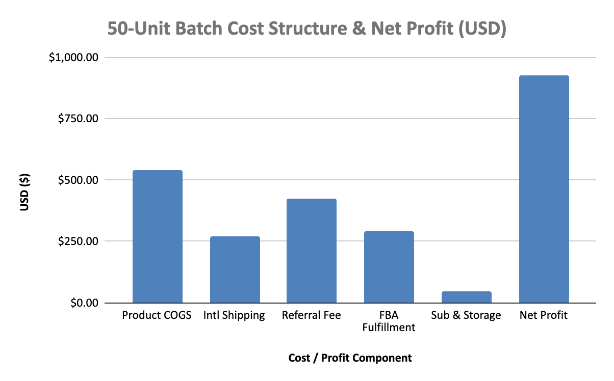
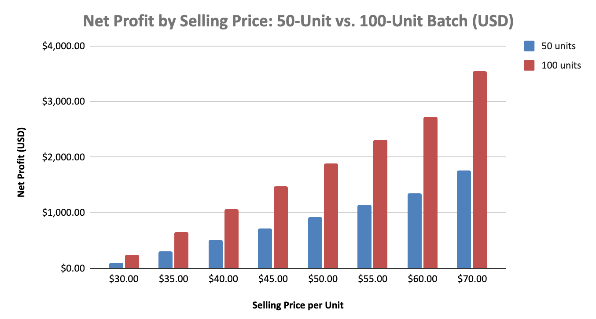

# Zindabad PK — Cross-Border Supply Chain & Unit Economics Analytics

**Tech Stack:** `SQL (PostgreSQL / SQLite)` `Python (pandas / sqlite3)`· `Microsoft Excel (Financial Modeling)` · `Cross-Border Logistics (PKR / USD)`

## 1. Business Overview
**Zindabad PK** is a New Jersey-registered e-commerce and cross-border trading operation sourcing regional apparel and home goods from Lahore, Pakistan for distribution via **Amazon FBA** in the United States. 

To eliminate pricing guesswork and protect margins against international air-freight and marketplace fees, I designed a **normalized 4-table relational SQL database** paired with a **dynamic multi-currency Excel unit-economics model**.

---

## 2. Database Architecture
The relational schema separates volatile currency exchange rates and Amazon fee schedules from static supplier costs (`PKR`) to prevent update anomalies:

* `exchange_rates` — Tracks historical and active `PKR/USD` conversion rates (`276.60 PKR = $1.00 USD`).
* `products` — Stores SKU metadata, unit weights (`kg`), supplier COGS (`PKR`), international freight (`PKR`), and target retail pricing (`USD`).
* `amazon_fee_schedules` — Models marketplace referral percentages (`17.0%`), FBA fulfillment fees (`$5.81/unit`), monthly storage (`$0.0864/unit`), and fixed seller subscriptions (`$39.99/mo`).
* `procurement_batches` — Logs batch quantities and legacy spreadsheet expense totals for automated audit reconciliation.

---

## 3. Key Analytical Findings & Financial Impact
* **Automated Audit Variance Detection:** Built a SQL reconciliation query that uncovered a **$429.25 cost understatement** in legacy budgeting sheets on a 50-unit apparel batch (`$1,144.01` recorded vs. `$1,573.26` actual reconciled cost), caused by a 50% COGS/freight summation omission and an FBA unit-count mismatch (`46.04` vs. `50` units).
* **Break-Even Floor Protection:** Established an exact **$31.47/unit break-even selling price** (or **31.5 units** at `$50.00/unit`), safeguarding a **37.1% net profit margin** (`$926.74` net profit per 50-unit batch).
* **SKU Viability Filtering:** Implemented conditional `CASE` and margin-threshold queries (`>= 30%` net margin) that flagged a `$30.00` promotional price tier as high-risk (**6.6% margin** before PPC ad spend), preventing unprofitable inventory allocation.
* ### Visual Model Breakdown

**50-Unit Batch Cost & Net Margin Breakdown**


**Price vs. Batch Volume Sensitivity Matrix ($30–$70 Retail Tiers)**


---

## 4. Reconciled SKU Performance Summary

| SKU ID | Product Line | Batch Qty | Target Price (USD) | Landed Unit Cost (USD) | Net Profit / Unit | Net Margin | Status |
| :--- | :--- | :---: | :---: | :---: | :---: | :---: | :--- |
| `ZPK-MAT-03` | Artisan Woven Mats | 23.6 | $668.00 | $306.95 | $361.05 | **54.0%** | Approved |
| `ZPK-APP-01` | Base Apparel (50-Unit Batch) | 50.0 | $50.00 | $31.47 | $18.53 | **37.1%** | Approved |
| `ZPK-DRS-02` | Embroidered Dresses (35kg) | 50.0 | $65.00 | $48.48 | $16.52 | **25.4%** | Watchlist |
| `ZPK-VAL-04` | Value Tier Apparel ($30 Promo) | 53.0 | $30.00 | $28.02 | $1.98 | **6.6%** | Rejected |

---

## 5. Featured SQL Audit Query (Variance Detection)
```sql
SELECT
    b.batch_id,
    p.sku_id,
    b.order_qty,
    b.legacy_recorded_expense_usd,
    ROUND(
        b.order_qty * (
            (p.unit_cogs_pkr + p.intl_shipping_pkr) / fx.rate_to_usd
            + f.fba_fulfillment_usd
            + (p.target_price_usd * f.referral_fee_pct)
            + f.monthly_storage_per_unit_usd
        ) + f.monthly_pro_sub_usd, 2
    ) AS reconciled_total_usd,
    ROUND(
        (b.order_qty * (
            (p.unit_cogs_pkr + p.intl_shipping_pkr) / fx.rate_to_usd
            + f.fba_fulfillment_usd
            + (p.target_price_usd * f.referral_fee_pct)
            + f.monthly_storage_per_unit_usd
        ) + f.monthly_pro_sub_usd) - b.legacy_recorded_expense_usd, 2
    ) AS variance_gap_usd
FROM procurement_batches b
JOIN products p ON b.sku_id = p.sku_id
JOIN amazon_fee_schedules f ON p.sku_id = f.sku_id
JOIN exchange_rates fx ON fx.currency_pair = 'PKR/USD'
WHERE b.legacy_recorded_expense_usd IS NOT NULL
  AND ABS(reconciled_total_usd - b.legacy_recorded_expense_usd) > 10.00;
```
---

## 6. Repository Structure
* `README.md` — Executive summary, database architecture, and analytical findings.
* `Zindabad_PK_Live_FX_Google_Sheets_Model.xlsx` — Google Sheets-compatible workbook integrated with `GOOGLEFINANCE("CURRENCY:USDPKR")` for real-time exchange rate tracking and live margin recalculation.
* `sql/zindabad_pk_analytics.sql` — Full DDL (`CREATE TABLE`), sample seed data, CTE unit economics, break-even aggregations, and audit variance queries.
* `Zindabad_PK_Amazon_Unit_Economics_Model_v2.xlsx` — 3-tab dynamic Excel workbook featuring reconciled P&L, SKU comparisons, and a price-vs-volume sensitivity matrix.
* `python/etl_pipeline.py` — Automated `pandas` & `sqlite3` ETL pipeline for PKR-to-USD conversion and variance reporting.
